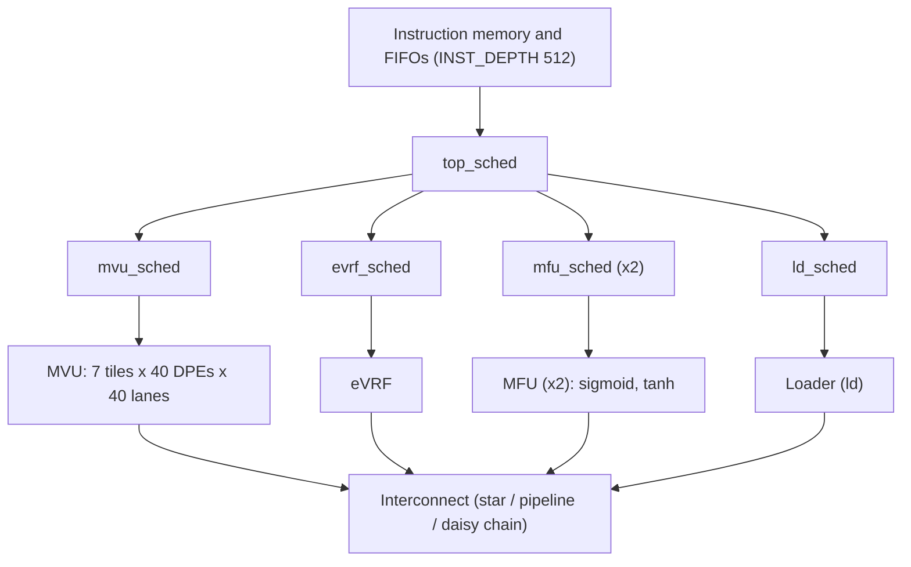

# FPGA-NPU on Virtex-7 VC707 Evaluation Board (part No: xc7vx485tffg1761-2)

**RTL Design | System Verilog | Verification | FPGA**

## Contents

- [Overview](#overview)
- [Target Device](#target-device)
- [Architecture](#architecture)
- [Asymmetric FIFO (implemented block)](#asymmetric-fifo-implemented-block)
- [Subcomponents](#subcomponents)
- [Parameters](#parameters)
- [Variables](#variables-internal-signals-of-the-fifo-block)
- [User I/O](#user-io)
- [Implementation Results](#implementation-results)
- [XDC Constraints](#xdc-constraints)
- [Timing Summary](#timing-summary)
- [Power Summary](#power-summary)
- [Implementation Notes](#implementation-notes)
- [Verification](#verification)
- [Project Files](#project-files)

## Overview

The Neural Processing Unit (NPU) is an FPGA soft-processor (overlay) architecture for low-latency, low-batch AI inference. It follows the "persistent AI" approach: all model weights stay in on-chip memory, so inference never waits on off-chip memory. The NPU is a domain-specific, software-programmable processor, so once its bitstream is deployed it can run different AI workloads from software.

> **Note:** the NPU RTL comes from the open-source Intel [`fpga-npu`](https://github.com/intel/fpga-npu) project, originally written for Intel Stratix 10 / Arria 10 devices. In this project it has been ported to Vivado: the Intel `scfifo` FIFO IP is replaced by a synthesizable Verilog FIFO core (`fifo.sv`), and the project is set up for a Xilinx Virtex-7 board.

**What was implemented in this run:** the project contains the full NPU RTL (41 source files), but the synthesis and implementation top module is `asymmetric_fifo`, a standalone 96-bit to 32-bit FIFO block from the NPU RTL (the MVU itself uses the related `asym_fifo` module from `fifo.sv`). All timing, power and utilization results in this README are for that block. The full NPU top module (`npu`) is not part of these results.

## Target Device

| Item | Value |
|---|---|
| Device | xc7vx485tffg1761-2 (Virtex-7 VX485T) |
| Board | Xilinx VC707 (`xilinx.com:vc707:part0:1.5`) |
| Package / speed grade | FFG1761 / -2 |
| Tool | Vivado v2026.1 |
| Synthesis / implementation top | `asymmetric_fifo` |
| Simulation top | `npu_tb` |
| Device resources | 303,600 LUTs, 607,200 flip-flops, 1,030 RAMB36, 2,800 DSP, 700 bonded IOB |

## Architecture

The NPU is built from schedulers, a matrix-vector unit (MVU) made of tiles of dot-product engines, an external vector register file unit (eVRF), two multi-function units (MFUs), a loader and the interconnects that link them. Instructions flow through an instruction memory and FIFOs to the schedulers, which control each unit. The sizes below come from `npu.vh`.



*High-level structure of the NPU, from the RTL in the project.*

## Asymmetric FIFO (implemented block)

`asymmetric_fifo` is a width-converting FIFO. A 96-bit write word is split into three 32-bit lanes that are written together into three identical FIFOs (`fifo0`, `fifo1`, `fifo2`). On the read side, one 32-bit word comes out per read, taken from the three FIFOs in turn: a 3-bit one-hot register (`sel`) starts at `3'b001` and rotates on every `rd_en`, and it selects which FIFO is read and which FIFO's `rd_data`, `rd_ok` and `usedw` are presented at the output. Each FIFO is an inferred `fifo_core` (512 words x 32 bits, first-word-fall-through).

```systemverilog
always @ (posedge clk) begin
    if (rst) begin
        sel <= 3'b001;
    end else begin
        if (rd_en) begin
            sel <= (sel == 3'b100)? 3'b001: (sel << 1);
        end
    end
end
```


*Synthesized schematic of `asymmetric_fifo`: three FIFO instances, the `sel` register, AND gates for `rd_en` and the output multiplexers.*

## Subcomponents

**Implemented block:** `asymmetric_fifo` contains 3 FIFO instances plus the select logic:

| # | Subcomponent | Function |
|---|---|---|
| 1 | `fifo0` (`fifo` / `fifo_core`) | Stores bits [31:0] of each write word |
| 2 | `fifo1` (`fifo` / `fifo_core`) | Stores bits [63:32] of each write word |
| 3 | `fifo2` (`fifo` / `fifo_core`) | Stores bits [95:64] of each write word |
| 4 | `sel[2:0]` register and shift logic | One-hot read pointer that rotates on each read |
| 5 | Read-enable AND gates (x3) | Gate `rd_en` with `sel` so only one FIFO is read at a time |
| 6 | Output multiplexers | Select `rd_data`, `rd_ok` and `usedw` from the active FIFO |

**Full NPU (project RTL, 41 files):**

| Group | Modules |
|---|---|
| Top and schedulers | `npu`, `top_sched`, `mvu_sched`, `evrf_sched`, `mfu_sched`, `ld_sched` |
| Matrix-vector unit | `mvu`, `mvu_tile`, `mvu_vrf`, `dpe`, `dpe_mrf`, `mrf_ram`, `bram_accum` |
| Vector and function units | `evrf`, `mfu`, `ld`, `sigmoid`, `tanh` |
| DSP and dot-product blocks | `nx_dot6_int8`, `nx_dot_product_int8`, `prime_dsp_tensor_int8`, `nx_axbs`, `nx_axbs_core`, `nx_axbs_slice`, `axbs` |
| Interconnect | `star_interconnect`, `pipeline_interconnect`, `daisy_chain_interconnect` |
| Memory and FIFOs | `fifo`, `asymmetric_fifo`, `inst_fifo`, `inst_ram`, `ram`, `altera_syncram`, `dma_buffer` |
| Test support | `shim`, `self_tester_shim`, `tester_rom`, `pcie_ed_MEM`, testbenches `npu_tb` and `self_tester_tb` |

## Parameters

Parameters of the implemented block (from the synthesis log and `npu.vh`):

| Parameter | Value | Meaning |
|---|---|---|
| `ACCW` | 32 | Accumulation / output bit width (`ODW`) |
| `IDW` | 96 (3 x `ACCW`) | Input (write) data width |
| `DEPTH` (`QDEPTH`) | 512 | Depth of each FIFO |
| `AW` | 9 | Address / `usedw` width (`$clog2(DEPTH)`) |
| `ID` | 0 | Instance identifier |
| `AFV` | 502 | Almost-full threshold in `fifo_core` (`wr_ok` drops at this count) |
| `SHOWAHEAD` | 1 | First-word-fall-through read |
| `USE_BRAM` | 1 | Requests block RAM (Vivado used distributed RAM, see results) |

Main parameters of the full NPU (`npu.vh`). The values marked with an asterisk are also visible as constants in the simulation waveform (see [Verification](#verification)):

| Parameter | Value | Meaning |
|---|---|---|
| `NTILE` * | 7 | MVU tiles |
| `NDPE` * | 40 | Dot-product engines per tile |
| `DOTW` | 40 | Lanes per DPE |
| `EW` | 8 | Input element width (8 or 4) |
| `ACCW` | 32 | Accumulation width |
| `NMFU` * | 2 | Multi-function units |
| `NVRF` * | 12 | Vector register files (from the waveform) |
| `NMRF` * | 280 | Matrix register files (from the waveform) |
| `VRFD` / `MRFD` * | 512 / 512 | Vector / matrix register file depth |
| `VRFAW` / `MRFAW` * | 9 / 9 | Vector / matrix register file address width |
| `NSIZE` / `NSIZEW` * | 512 / 10 | Native size and its width |
| `NTAG` / `NTAGW` * | 512 / 9 | Number of instruction tags and its width |
| `QDEPTH` | 512 | FIFO depth |
| `INST_DEPTH` | 512 | Instruction memory depth |
| `DOT_PER_DSP` * | 3 | Dot products per DSP block |
| `PRIME_DOTW` * | 10 | Prime dot-product width |
| `NUM_DSP` * | 4 | DSP blocks per DPE |
| `TILES_THRESHOLD` / `DPES_THRESHOLD` | 8 / 0 | Tiles and DPEs per tile built from hard DSP blocks |

## Variables (internal signals of the FIFO block)

| Name | Width | Purpose |
|---|---|---|
| `sel` | 3 | One-hot rotating FIFO select |
| `fifo_wr_ok`, `fifo_rd_ok` | 3 each | Per-FIFO write-OK and read-OK flags |
| `fifo_rd_data[0:2]` | 3 x 32 | Per-FIFO read data |
| `fifo_usedw[0:2]` | 3 x 9 | Per-FIFO occupancy |
| `rd_data_out`, `rd_ok_out`, `usedw_out` | 32, 1, 9 | Multiplexed outputs |
| `wptr`, `rptr`, `count` (in `fifo_core`) | 9, 9, 10 | Write pointer, read pointer and occupancy counter of each FIFO |

## User I/O

| Signal | Direction | Bits |
|---|---|---|
| `clk`, `rst` | In | 2 |
| `wr_en` | In | 1 |
| `wr_data[95:0]` | In | 96 |
| `rd_en` | In | 1 |
| `wr_ok` | Out | 1 |
| `rd_data[31:0]` | Out | 32 |
| `rd_ok` | Out | 1 |
| `usedw[8:0]` | Out | 9 |

**Totals:** **143 user I/Os** (100 inputs, 43 outputs), which is 20.43% of the 700 bonded IOBs on the device.

## Implementation Results

| Resource | Used | Available | Util % |
|---|---|---|---|
| Slice LUTs (all) | 1,505 | 303,600 | 0.50 |
| LUT as logic | 449 | 303,600 | 0.15 |
| LUT as memory (distributed RAM) | 1,056 | 130,800 | 0.81 |
| Slice registers (flip-flops) | 183 | 607,200 | 0.03 |
| Slices | 446 | 75,900 | 0.59 |
| Block RAM | 0 | 1,030 | 0.00 |
| DSP | 0 | 2,800 | 0.00 |
| Bonded IOB | 143 | 700 | 20.43 |
| BUFGCTRL | 1 | 32 | 3.13 |
| Unique control sets | 31 | 75,900 | 0.04 |

Vivado's RTL statistics show three 512 x 32-bit RAMs (one per FIFO). They were mapped to distributed (LUT) RAM, which explains the 1,056 memory LUTs and the zero block RAM. Synthesis finished with 0 errors, 0 critical warnings and 12 warnings.

## XDC Constraints

The project constraint file `FPGA_NPU.xdc` is written for the full NPU top level. It defines a 100 MHz clock with 0.1 ns uncertainty, input delays of 0.5 to 1.0 ns and output delays of 1.5 ns on the NPU interfaces (MRF write, instruction chain, loader and control ports), false paths on reset and debug signals, and multicycle paths on the top scheduler:

```tcl
create_clock -name clk -period 10 [get_ports clk]
set_clock_uncertainty 0.1 [get_clocks clk]

set_input_delay  -clock clk 1.0 [get_ports i_ld_in_wr_en]
set_input_delay  -clock clk 1.0 [get_ports i_ld_in_wr_din]
set_output_delay -clock clk 1.5 [get_ports o_ld_out_rd_dout]
set_input_delay  -clock clk 1.0 [get_ports i_start]
set_output_delay -clock clk 1.5 [get_ports o_done]

set_false_path -from [get_pins -hierarchical -filter {NAME =~ *rst*}]
set_multicycle_path 2 -from [get_clocks clk] -to [get_pins -hierarchical -filter {NAME =~ *top_sched*}]
set_operating_conditions -typical
```

Because the implemented top is `asymmetric_fifo`, only the clock constraint applies to it; the I/O delays refer to NPU ports that do not exist on this block. Several commands in the file (`place_cell`, `set_max_fanout`, `set_directive`, `get_loops` and `route_design`) are not supported in an XDC file, which produces 44 critical warnings across the run. The second constraint file, `NPU_constraints.xdc`, is empty. No pin locations are assigned, so all 143 I/Os were placed automatically.

## Timing Summary

All user-specified timing constraints are met for the 100 MHz clock: worst setup slack is +4.585 ns, worst hold slack is +0.079 ns and worst pulse-width slack is +4.232 ns, with no failing endpoints.

| Check | Worst slack | Total negative slack | Failing endpoints | Total endpoints |
|---|---|---|---|---|
| Setup (WNS / TNS) | 4.585 ns | 0.000 ns | 0 | 7,614 |
| Hold (WHS / THS) | 0.079 ns | 0.000 ns | 0 | 7,614 |
| Pulse width (WPWS / TPWS) | 4.232 ns | 0.000 ns | 0 | 1,240 |


*Vivado Design Timing Summary for `asymmetric_fifo`.*

## Power Summary

Total on-chip power is 0.275 W. Static power is 88% of the total, and 57% of the dynamic power is in the I/O.

| Metric | Value |
|---|---|
| Total on-chip power | 0.275 W |
| Dynamic power | 0.032 W (12%) |
| Dynamic: clocks | 0.005 W (15%) |
| Dynamic: signals | 0.006 W (18%) |
| Dynamic: logic | 0.003 W (10%) |
| Dynamic: I/O | 0.018 W (57%) |
| Device static power | 0.242 W (88%) |
| Junction temperature | 25.3 °C |
| Thermal margin | 59.7 °C (50.6 W) |
| Ambient temperature | 25.0 °C |
| Effective θJA | 1.1 °C/W |
| Design power budget | Not specified |
| Process | typical |
| Confidence level | Low |


*Vivado power analysis of the implemented netlist (vectorless activity, so confidence is low).*

## Implementation Notes

| Check | Severity | Meaning in this design |
|---|---|---|
| NSTD-1 | Critical Warning | I/O standard not specified for the ports (default used) |
| UCIO-1 | Critical Warning | Ports have no pin constraint |
| TIMING-18 | Warning | 142 ports have no input or output delay |
| CFGBVS-1 | Warning | `CFGBVS` and `CONFIG_VOLTAGE` are not set |

## Verification

The project includes the NPU testbench (`npu_tb.sv`) and a self-tester testbench (`self_tester_tb.v`) together with the self-tester shim and ROM. The FIFO block was taken through synthesis, implementation, timing and power analysis as described above.

The waveform below is the Vivado simulator view of `npu_tb` over 0 to 1,000 ns. It shows the NPU configuration constants of the testbench: `NTILE` = 7, `NDPE` = 0x28 (40), `NMFU` = 2, `NVRF` = 0xc (12), `NMRF` = 0x118 (280), `VRFD` and `MRFD` = 0x200 (512), `VRFAW` and `MRFAW` = 9, `NSIZE` = 0x200 (512), `NSIZEW` = 0xa (10), `NTAG` = 0x200 (512), `NTAGW` = 9, `DOT_PER_DSP` = 3, `PRIME_DOTW` = 0xa (10) and `NUM_DSP` = 4. All of them hold one constant value for the whole window, and they agree with the values in `npu.vh`. This confirms that the testbench elaborates with the intended configuration. It does not show instruction execution, FIFO data or a pass/fail result, so no functional verification result is claimed.


*Simulation waveform of `npu_tb`: configuration constants over 0 to 1,000 ns.*

## Project Files

Source code and documentation are available in the [original Intel repository](https://github.com/intel/fpga-npu) (the project has been discontinued by Intel). This Vivado project contains:

- 41 RTL files in `rtl/` (SystemVerilog and Verilog) and the macro header `npu.vh`.
- `fifo.sv`: the synthesizable Vivado replacement for the Quartus `scfifo` FIFOs.
- Testbenches `npu_tb.sv` and `self_tester_tb.v`.
- Constraint files `FPGA_NPU.xdc` and `NPU_constraints.xdc`.

---

&copy; 2026 Aravindakshan GA. All rights reserved.
